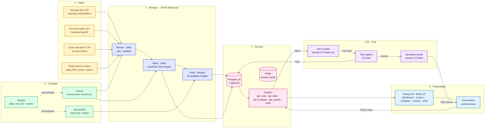
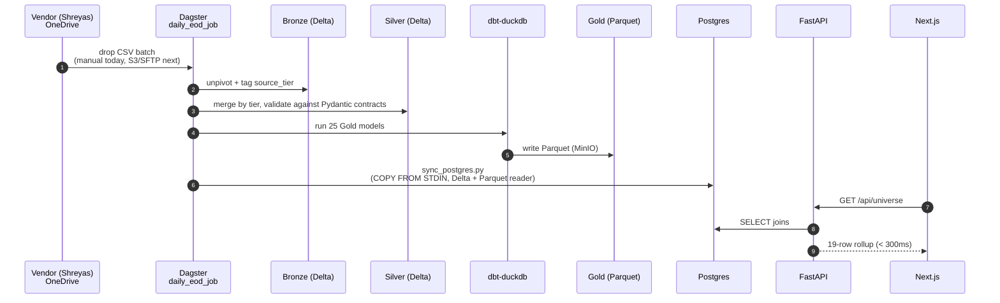
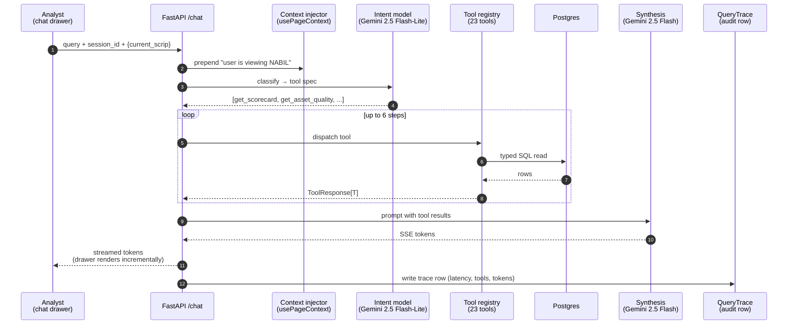

# NEPSE Research Platform — Architecture

*A one-stop architectural map of the platform: every tier, every component, every data hop from vendor CSV to the LLM-powered research UI. Designed for internal pitch meetings, onboarding, and ongoing review.*

**Last updated:** April 2026 · **Status:** Phase I + J delivered · **Scope:** 19 Commercial Banks on NEPSE

---

## 1 · The platform at a glance

The platform is a 5-tier pipeline that turns vendor CSVs into a **research cockpit** for NIMB Ace Capital's research analysts. A chat interface sits alongside the dashboards and talks to the same serving tier via a tool registry.



**Two thematic observations:**

1. **CSV-primary, not scraper-primary.** Vendor CSVs are the authoritative source; the Sharesansar scraper is a fallback for domains the vendor doesn't ship (indices, corporate actions). Silver merges by source-tier: `CLIENT_AUTHORITATIVE` > `CLIENT_HISTORICAL` > `SCRAPED`.
2. **The chat is not a separate pipeline.** It's a thin LLM wrapper around the same 23 tools that read the same Postgres serving tables the dashboards read. One data path, two surfaces.

---

## 2 · Daily EOD run — sequence

One full daily run, in order, from vendor drop to user-visible page refresh.



Key operational numbers today:
- **Volume:** ~19 scrips × ~20 quarters × ~55 metrics ≈ 21 k rows in `silver.fundamentals`; ~100 k rows in `silver.prices` (2.5 years × 19 scrips × 250 trading days); ~480 rows in `gold.investment_scorecard` (1 per scrip per quarter).
- **Latency:** end-to-end daily run fits well inside one business hour once the vendor drop lands.
- **SLA target:** CSV drop by 18:00 NPT → user-visible numbers updated by 19:00 NPT same day.

---

## 3 · Chat turn — sequence

A single analyst query, drawer to answer, in the order operations happen.



Two properties worth naming:
- **Context injection** is a pathname → JSON bundle computed in the frontend (`services/web/src/lib/use-page-context.ts`) and passed as `ChatRequest.context`. The agent prepends a one-liner to the system prompt — no change to session memory.
- **Trace audit.** Every turn writes a row to `query_traces` with tool list, latency, tokens, model used. This is the basis for later cost monitoring and quality review.

---

## 4 · Tier-by-tier breakdown

### 4.1 · Ingest

| Source | File pattern | Grain | Cadence | Tier | Reader |
|---|---|---|---|---|---|
| Shreyas tidy CSV | `cbbalancesheet2_*.csv`, `cbincomestatement_*.csv`, `cbadditionalinfo_*.csv` | (scrip, fy_bs, quarter) | Quarterly | `CLIENT_AUTHORITATIVE` | `services/ingestion/nrc_ingestion/sources/client_csv/shreyas_fundamentals.py` |
| Format B wide CSV | `Commercial bank {key stats\|balance sheet\|Income Statement}/<TICKER>.csv` | (scrip, fy_bs, quarter) | Ad-hoc backfill | `CLIENT_HISTORICAL` | `format_b_fundamentals.py` |
| Format B close-only | `Commercial bank Price 5 years/<TICKER>.csv` | (scrip, date) | Ad-hoc backfill | `CLIENT_HISTORICAL` | `format_b_prices.py` |
| Sharesansar scraper | web endpoints | (scrip, date) or event | Daily / ad-hoc | `SCRAPED` | `scrapers/` + Dagster `bronze_scraper` assets |

The ingest contract — what an incoming CSV must look like — is described in detail in [`DATA_VENDOR_CONTRACT.md`](./DATA_VENDOR_CONTRACT.md).

### 4.2 · Storage — MinIO lakehouse

| Layer | Format | Bucket / path | Writer | Why |
|---|---|---|---|---|
| Bronze | Delta | `s3://nepse-lakehouse/bronze/*` | Python + `nrc_storage.DeltaIO` | Append-only; keeps every vendor drop with a `source_file` lineage column so nothing is lost if a later canonicalisation rule changes. |
| Silver | Delta | `s3://nepse-lakehouse/silver/*` | Python canonicalisers (`services/processing/nrc_processing/silver_*.py`) | Tier-merged, contract-validated (Pydantic), wide snapshot joins. |
| Gold | Parquet | `s3://nepse-lakehouse/gold/*.parquet` | dbt-duckdb (`dbt/models/gold/*.sql`) | Parquet because the dbt-duckdb plugin's Delta writer support is uneven; Parquet is read cleanly by DuckDB, pyarrow, and Postgres `COPY` via pyarrow.fs.S3FileSystem with the MinIO endpoint override in `libs/storage/nrc_storage/delta_io.py`. |

Compose service: `minio` (image `minio/minio:latest`, container `nrc_minio`, ports 9000 S3 / 9001 console). Defined in `docker-compose.yml`.

### 4.3 · Compute

**DuckDB** (v1.1+) — the in-process analytics engine. Silver transformations run as DuckDB SQL against Bronze Delta tables. Cheap, fast, no cluster needed. Abstraction lives at `libs/compute/nrc_compute/engine.py` so the same queries could later run on Spark.

**dbt-duckdb** (v1.8–1.10) — every Gold model. SQL-first, version-controlled, `dbt run` builds all 25 into Parquet in one pass. Project dir: `dbt/`.

**Dagster** (v1.9–2.0) — orchestration. Assets, jobs, schedules declared in `services/pipelines/nrc_pipelines/`. Key entry points:

| Asset group | Files | What it does |
|---|---|---|
| `bronze_client_csv` | `nrc_pipelines/assets/bronze_csv.py` | Calls the three CSV ingesters |
| `bronze_scraper` | `nrc_pipelines/assets/bronze_scraper.py` | Manual refresh of scraper data |
| `silver` | `nrc_pipelines/assets/silver.py` | 8 canonicaliser transforms |
| `gold` | `nrc_pipelines/assets/dbt_analytics.py` | Wraps dbt run via `dagster-dbt` |
| `postgres_sync` | `nrc_pipelines/assets/postgres_sync.py` | Final Parquet → Postgres load |

Dagster webserver runs locally via `uv run dagster dev -m nrc_pipelines --port 3001`.

### 4.4 · Serving

**Postgres 16 + pgvector** — single source of truth for the dashboards and tool layer. All Gold Parquet tables are mirrored here via `services/processing/nrc_processing/sync_postgres.py`. Schema lives in `infra/postgres/schema/{001_serving_tables.sql, 002_realtime_tables.sql, 003_gold_phase_i_j.sql}`. Extensions: `pgvector` (embeddings for future semantic search), `pg_trgm` (text search).

**FastAPI** — read-only HTTP over Postgres, structured by domain:

| Router | File | Routes |
|---|---|---|
| Universe-scoped | `api_data.py` | `/api/universe`, `/api/universe/sparklines`, `/api/indices`, `/api/stage2`, `/api/scorecard`, `/api/quadrant`, `/api/sector-momentum`, `/api/prices/{scrip}` |
| Scrip-scoped | `api_scrip.py` | `/api/scrip/{s}/{summary\|fundamentals-history\|valuation-history\|returns\|piotroski\|dupont\|asset-quality\|capital\|dividends\|technicals\|quality}` |
| Compare | `api_compare.py` | `/api/compare?scrips=...` |
| Screens | `api_screen.py` | `/api/screen/{top-quality\|cheap-vs-self\|high-yield\|contrarian\|turnaround}` |
| Chat | `server.py` | `POST /chat` (SSE), `DELETE /chat/session/{id}` |

Connection pooling via `psycopg3` — `request.app.state.pg`. Bulk-efficient for the dashboard's one-shot queries.

**Redis 7** — chat session memory. Conversation history across turns lives here; TTL-bounded. `services/orchestrator/nrc_orchestrator/conversation.py`.

### 4.5 · Presentation

**Next.js 16.2** (App Router) + **React 19.1** + **Tailwind 4** (see `services/web/package.json`).

Data layer: `TanStack Query v5` for caching + retries, `TanStack Table v8` for the dashboard grid. Charts: `Recharts v3`. Icons: `lucide-react`. Markdown in chat: `react-markdown` + `remark-gfm`.

Routes (all client components since they use live Postgres reads):

| Path | File | Purpose |
|---|---|---|
| `/dashboard` | `app/(main)/dashboard/page.tsx` | Universe overview + 4 stat tiles + filterable table |
| `/scrip/[symbol]` | `app/(main)/scrip/[symbol]/page.tsx` | 8-tab deep dive (Performance / Fundamentals / Valuation / Asset quality / Capital / Income / Technicals / Quality) |
| `/compare?scrips=A,B,C` | `app/(main)/compare/page.tsx` | Transposed metric grid with best-in-row heatmap |
| `/screen/[preset]` | `app/(main)/screen/[preset]/page.tsx` | 5 pre-built strategy filters |
| `/chat` | `app/(main)/chat/page.tsx` | Full chat history browser + visual panel |
| `/help` | `app/help/page.tsx` | Standalone docs (system + metrics), opens in new tab |
| Drawer (every `(main)` page) | `components/chat-drawer/chat-drawer.tsx` | Persistent, context-aware, collapsible chat |
| Command palette | `components/command-palette/command-palette.tsx` | ⌘K global overlay |

### 4.6 · LLM / chat

Two-tier router in `libs/llm/nrc_llm/router.py` — cheap intent classifier + full synthesis model:

| Tier | Model | Role | Config |
|---|---|---|---|
| Intent | `gemini-2.5-flash-lite` | Decide which of the 23 tools to call | `libs/llm/nrc_llm/config.py` |
| Synthesis | `gemini-2.5-flash` (or `-pro`) | Weave tool results into the answer | Same |

Auth: Vertex API key via `.env` (`GCP_VERTEX_API_KEY`, `GCP_PROJECT_ID`). Client library: `google-genai>=0.8`.

**Tool registry** — `services/tools/nrc_tools/__init__.py`. 23 tools today:

| Category | Tools |
|---|---|
| Discovery | `list_scrips` |
| Prices / quotes | `get_quote`, `get_live_quote`, `get_price_history` |
| Fundamentals | `get_fundamentals`, `get_fundamentals_history`, `get_dupont`, `get_piotroski` |
| Asset quality & capital | `get_asset_quality`, `get_capital` |
| Valuation | `get_valuation`, `get_valuation_history` |
| Returns & risk | `get_returns`, `get_technicals`, `get_technical_posture` |
| Dividends | `get_dividend_history`, `get_corporate_actions` |
| Composites | `get_scorecard`, `get_quadrant` |
| Peer | `get_peer_rankings` |
| Screens | `stage1_screen`, `stage2_bank_screen` |
| News | `get_news` |

Each tool follows the same pattern: Pydantic input, typed DB read via `request.app.state.pg`, return `ToolResponse[T]` with a `data_as_of` timestamp and `sources` list. This makes the agent's output reproducible — given the same tool calls and the same DB state, the same answer.

---

## 5 · 25 Gold models — one table

dbt-duckdb materialises these from Silver on each daily run. Every model in `dbt/models/gold/*.sql`.

| # | Model | Grain | What it computes |
|---|---|---|---|
| 1 | `ttm_fundamentals` | (scrip, fy, q) | Trailing-twelve-month aggregates: ttm net profit, ttm roe/roa/nim. |
| 2 | `quarterly_growth` | (scrip, fy, q) | YoY / QoQ growth for 11 metrics. |
| 3 | `dupont_decomposition` | (scrip, fy, q) | ROE = ROA × EM = (margin × turnover) × leverage. |
| 4 | `cost_efficiency` | (scrip, fy, q) | Cost-to-income + component ratios. |
| 5 | `revenue_quality` | (scrip, fy, q) | Operating cash flow vs net profit alignment. |
| 6 | `asset_quality_trends` | (scrip, fy, q) | NPL trajectory, LLP coverage, TTM credit loss. |
| 7 | `capital_strength` | (scrip, fy, q) | CAR, Tier 1 share, buffer vs NRB 11%. |
| 8 | `dividend_yield` | (scrip, fy) | Cash/bonus yield, yield tier. |
| 9 | `piotroski_f_score` | (scrip, fy, q) | 9-signal bank-adapted F-score. |
| 10 | `price_returns` | (scrip) | 1M/3M/6M/1Y/3Y/5Y returns, drawdown, 20d vol. |
| 11 | `fundamental_quality_composite` | (scrip, fy, q) | 6-pillar quality 0-100 + tier. |
| 12 | `quality_momentum_matrix` | (scrip) | 2×2 quadrant on quality × 6M return. |
| 13 | `valuation` | (scrip, fy, q) | P/E, P/B vs sector median. |
| 14 | `valuation_history` | (scrip, fy, q) | 5-year self-percentile + self-valuation tier. |
| 15 | `operating_leverage` | (scrip, fy, q) | Fixed-cost structure, earnings sensitivity. |
| 16 | `market_cap_metrics` | (scrip) | Market cap, cap tier, enterprise value. |
| 17 | `beta_and_volatility` | (scrip) | 2Y beta vs NEPSE, alpha, R², Sharpe, vol. |
| 18 | `total_shareholder_return` | (scrip) | TSR 1Y/3Y/5Y including dividends. |
| 19 | `technical_signal_summary` | (scrip) | 5-rule posture (trend, MA, RSI, MACD, Bollinger). |
| 20 | `sector_momentum` | (sector) | Sector aggregates vs NEPSE. |
| 21 | `investment_scorecard` | (scrip) | 5-component composite 0-100. |
| 22 | `peer_rankings_quarterly` | (scrip, metric, fy, q) | Per-sector rank + percentile. |
| 23 | `stage1_screen_results` | (scrip) | Initial quality / liquidity filter pass. |
| 24 | `stage2_bank_screen` | (scrip) | Stage 1 winners rescored by quality + valuation + momentum. |
| 25 | `indicators_daily` | (scrip, date) | SMA 20/50/200, EMA 12/26, RSI 14, MACD, Bollinger, ATR. |

---

## 6 · Tech stack inventory

Every library that matters, its version, and the file that introduces it.

### 6.1 · Backend (Python)

| Library | Version | Role | Config |
|---|---|---|---|
| Python | 3.12 | Runtime | `.python-version` |
| uv | latest | Workspace manager | `pyproject.toml` (root) |
| DuckDB | 1.1+ | Local compute engine | `libs/compute/nrc_compute/duckdb_engine.py` |
| dbt-core | 1.8–1.10 | SQL transformations | `dbt/profiles.yml` |
| dbt-duckdb | 1.8–1.10 | DuckDB adapter for dbt | same |
| deltalake | 0.17+ | Delta reader/writer | `libs/storage/nrc_storage/delta_io.py` |
| pyarrow | 15+ | In-memory columnar, Parquet I/O | `libs/storage/nrc_storage/delta_io.py` |
| psycopg[binary] | 3.x | Postgres client | `libs/storage/nrc_storage/postgres_client.py` |
| FastAPI | latest | HTTP API | `services/orchestrator/nrc_orchestrator/server.py` |
| uvicorn | 0.30+ | ASGI server | same |
| Dagster | 1.9–2.0 | Orchestration | `services/pipelines/nrc_pipelines/definitions.py` |
| dagster-dbt | matching | Dagster ↔ dbt bridge | `services/pipelines/nrc_pipelines/assets/dbt_analytics.py` |
| Pydantic | 2.x | Data contracts | `libs/contracts/nrc_contracts/*.py` |
| google-genai | 0.8+ | Vertex Gemini client | `libs/llm/nrc_llm/vertex_gemini.py` |
| redis | 5.x | Session cache | `libs/storage/nrc_storage/redis_client.py` |
| pytest | 8+ | Unit tests | root `pyproject.toml` |
| ruff | 0.6+ | Lint + format | same |
| mypy | 1.10+ | Type check | same |

### 6.2 · Frontend (TypeScript)

| Library | Version | Role |
|---|---|---|
| Next.js | 16.2.4 | App Router, SSR, route groups |
| React | 19.1 | UI |
| TypeScript | 5.x | Types |
| Tailwind CSS | 4.x | Styling |
| TanStack Query | 5.99 | Data fetching + cache |
| TanStack Table | 8.21 | Headless table |
| Recharts | 3.8 | Charts |
| lucide-react | 1.8 | Icons (all — no emoji) |
| react-markdown + remark-gfm | 10.1 / 4.0 | Assistant-reply markdown |
| class-variance-authority | 0.7 | Variant styling |
| clsx + tailwind-merge | 2.1 / 3.5 | Class composition |

### 6.3 · Infra (Docker Compose)

| Service | Image | Ports | Role |
|---|---|---|---|
| `minio` | `minio/minio:latest` | 9000 / 9001 | Object store (lakehouse) |
| `minio-setup` | `minio/mc:latest` | — | One-shot bucket creator |
| `postgres` | `pgvector/pgvector:pg16` | 5432 | Serving DB |
| `redis` | `redis:7-alpine` | 6379 | Session cache, 200 MB LRU |

Volumes mount under `./data/{minio,postgres,redis}`. All services health-checked before dependent services start.

---

## 7 · Running the stack locally

Assuming `docker compose up -d` is green and `.env` has the required keys (`GCP_VERTEX_API_KEY`, `MINIO_ROOT_USER`, `POSTGRES_PASSWORD`):

```bash
# Start infra
docker compose up -d
# → minio :9000/:9001, postgres :5432, redis :6379

# Start Dagster for ingest / transform / sync
uv run dagster dev -m nrc_pipelines --port 3001
# → http://localhost:3001

# Start FastAPI
uv run nrc-serve --host 0.0.0.0 --port 8080
# → http://localhost:8080/docs

# Start Next.js
cd services/web && npm run dev
# → http://localhost:3000
```

Daily run: click `daily_eod_job` → Materialize in Dagster UI. All assets should turn green in one pass.

---

## 8 · Deferred / roadmap

Each bullet is an open data or engineering gap with a one-line blocker. These live as candidate work items, not commitments. Detail in [`NEXT_PHASES.md`](./NEXT_PHASES.md) and [`TECHNICAL_DEVELOPMENT_PLAN.md`](./TECHNICAL_DEVELOPMENT_PLAN.md).

- **Live market feed** — `live_quotes` + `tick_history` tables exist; real-time feed blocked on NEPSE TMS broker relationship.
- **Speculation detection** — requires broker-wise net-flow data + floor-sheet transaction tape. Blocked on the same TMS feed.
- **News sentiment** — `bronze.news_raw` scaffolded; ingestion + sentiment API deferred.
- **Multi-sector coverage** — 19 Commercial Banks today; Hydropower + Insurance + Microfinance + Development Banks have distinct schemas that need their own metric maps.
- **Backtesting / System B (Order Decision Review)** — requires historical order placements + approved-investment list from NIMB's internal systems.
- **Forward P/E from analyst estimates** — currently trailing-growth extrapolation; production path is Bloomberg/Refinitiv or a curated internal estimate table.
- **Automated vendor drop-point** — manual OneDrive today → SFTP / S3 bucket target. Spec in [`DATA_VENDOR_CONTRACT.md`](./DATA_VENDOR_CONTRACT.md) §7.

---

## 9 · Where to go next

- **New to the codebase?** Start with `docker compose up -d`, run the dashboard, then read `services/orchestrator/nrc_orchestrator/agent.py` for the chat loop and `dbt/models/gold/investment_scorecard.sql` for the headline composite.
- **New metric request?** The vendor might already provide what you need — check [`DATA_VENDOR_CONTRACT.md`](./DATA_VENDOR_CONTRACT.md). If yes, extend the metric map + Silver transform + add a dbt model + add a tool + add a UI column. If no, add a row to the vendor's nice-to-have checklist.
- **LLM quality issue?** Every turn writes a `query_traces` row. Cross-reference with the system prompt in `agent.py` — most quality issues trace to tool-selection or to the "no verdicts" directive being overridden.

*This document is living — extend it as new tiers are added (auth, BI export, notification service) rather than creating parallel docs.*
