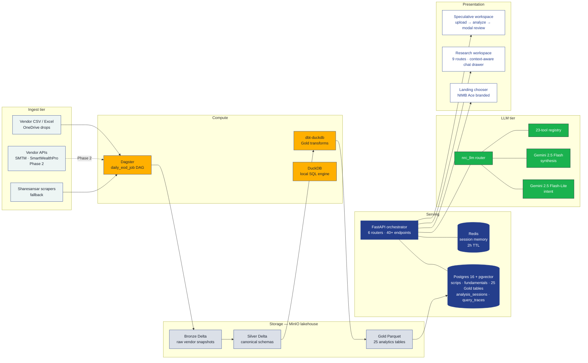
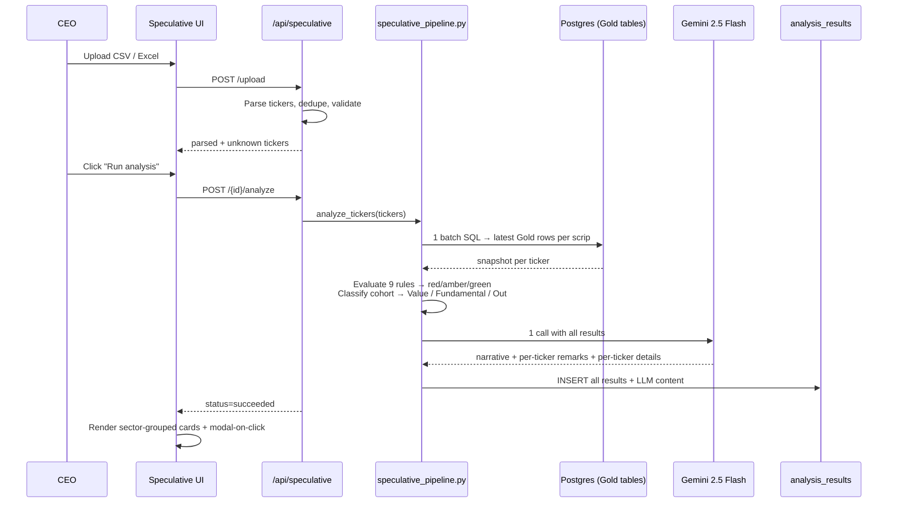

# Demo Slide Brief — NIMB Ace Research Platform

> **Instructions for the receiving Claude (paste-and-run prompt)**
>
> You are producing a slide deck for an internal demo at **NIMB Ace Capital** —
> a Nepalese investment-banking subsidiary of NIMB. The audience is mixed:
> NIMB leadership (CEO, COO, research head) plus the dev/management team.
> Build the deck using **Marp markdown** (single `.md` file, `---` for slide
> breaks, front-matter at the top setting `theme: default` + `paginate: true`).
> Aim for **~22 slides**. Brand colours are navy `#243E8C` (primary), green
> `#1AB24F` (positive), red `#D2202F` (negative), gold `#FFB000` (highlight),
> body `#575757`, background `#f8f9fb`. Fonts: **Archivo** sans, **JetBrains
> Mono** for numbers. **No emojis.** Dense over whitespace. Tabular numerics.
>
> Use the structure in **§6 — Suggested slide structure** below as the
> exact slide outline. Embed the Mermaid diagram from **§4** as the
> architecture slide. Keep code/architecture slides factual; keep
> roadmap/vision slides outcome-led. Generate placeholder cues where a
> screenshot belongs (`[screenshot: dashboard]`) — do not invent images.
>
> Output the full Marp markdown in a single fenced code block so it can be
> copy-pasted into a `demo.md` file directly.
>
> ---

## 1 · Product story (the elevator pitch)

**NIMB Ace Research Platform** is an internal, AI-augmented investment-research
cockpit covering the 19 active commercial banks listed on NEPSE. Today,
research analysts work out of Excel files and Word reports passed manually
between team members. The platform replaces that with a unified data layer
(15+ years of quarterly fundamentals + daily price bars), 25+ computed
analytics tables refreshed nightly, and two product surfaces tuned to
different users.

**Two workspaces share the same data tier:**

- **Research workspace** — for analysts. Universe browser, per-scrip deep
  dives, side-by-side comparison, preset screens, context-aware chat.
- **Speculative Analysis** — for the CEO / decision-makers. Upload a
  shortlist (CSV/Excel) → platform runs a 9-rule analyzer + cohort
  classifier + LLM narrative → per-ticker verdicts with red/amber/green
  flags and a "Why this verdict" detail modal. Sessions persist in
  Postgres so the CEO can return days later.

Both surfaces consume the same Postgres-served Gold-layer analytics. Nothing
is hard-coded — the cohort thresholds and rule weights live in a single
constants block ready for the research team to tune.

---

## 2 · What's done — Phase 1 (delivered, Q1–Q2 2026)

### Data foundation
- **Lakehouse architecture**: MinIO (S3-compatible) holds Bronze Delta + Silver
  Delta + Gold Parquet tiers. DuckDB does local SQL; dbt-duckdb materialises
  the 25-model Gold layer; **Dagster** orchestrates the daily DAG with
  asset-level lineage.
- **6 Postgres migrations** apply the serving schema:
  - `001_serving_tables.sql` — scrips, daily_bars, fundamental_snapshots,
    query_traces (audit), Stage-2 bank screen
  - `002_realtime_tables.sql` — live ticks cache + tick history
  - `003_gold_phase_i_j.sql` — 20 Gold analytics tables (TTM, DuPont,
    Piotroski, valuation history, scorecard, quadrant, capital strength,
    asset-quality trends, dividend yield, returns, beta/vol, TSR, technical
    signal summary, sector momentum, investment scorecard…)
  - `004_speculative_analysis.sql` — analysis_sessions, analysis_results,
    analysis_chat_turns
  - `005_speculative_cohort.sql` — cohort + cohort_reason columns
  - `006_speculative_detail_rationale.sql` — per-ticker LLM verdict paragraph
- **On-demand pipeline refresh** — button on `/data-coverage` that triggers
  the Dagster `daily_eod_job` over GraphQL so non-engineers can rebuild data
  without SSH-ing into anything.

### Research workspace (`(main)/` route group)
- `/dashboard` — universe table with composite scores, quadrant, 6m return,
  P/E self-percentile, dividend yield, market-cap tier. Filter bar (sector,
  size, quality, quadrant, NPL band). URL-shareable filter state.
- `/scrip/[symbol]` — 8-tab deep dive: Performance · Fundamentals ·
  Valuation · Asset Quality · Capital · Income · Technicals · Quality.
  Hash-linkable tabs. Sparklines + 14-yr price chart + drawdown overlay.
- `/compare?scrips=A,B,C` — transposed metric grid, 2-5 scrips,
  delta column + heat-map shading. Normalized price overlay at top.
- `/screen/[preset]` — 5 hard-coded strategies (top-quality,
  cheap-vs-self, high-yield, contrarian, turnaround).
- `/live` — live quote ticker (currently driven by `nrc-simulate`).
- `/chat` — persistent chat history; full-page conversation browser.
- `/data-coverage` — single-source-of-truth inventory of what's in the
  Postgres serving layer + sectors covered + refresh CTA.
- **Right-side chat drawer** mounted on every research page; context-aware
  from the current route (`/scrip/NABIL` → drawer injects `current_scrip`
  into the LLM system prompt so "how is its CAR trending?" works without
  restating the ticker).
- **Command palette** (⌘K) — search scrips, navigate, ask chat, run
  multi-token commands ("compare NABIL NICA HBL").
- **Dark mode** — full dual theme, persisted to localStorage.

### Speculative workspace (`(speculative)/` route group)
- `/speculative` — list of past analyses with per-row flag-distribution
  mini-bar + cohort counts + status pill.
- `/speculative/new` — CSV/Excel upload, parsed ticker preview,
  unknown-ticker filtering against active universe.
- `/speculative/analysis/[id]` — analysis view:
  - Header with cohort counters (**Value / Fundamental / Out of Universe**)
    above flag counters (Green / Amber / Red / Unknown).
  - **Sector outlook panel** per sector — aggregate Mean PE, Mean NPL,
    Profit YoY, Div Yield, 6m Return, cohort split.
  - **Per-ticker cards** sectioned by sector. Each card: ticker + company
    + cohort badge + flag badge + inline metric strip (EPS · PE · CAR ·
    NPL · Rating) + one-line remark.
  - **Detail modal on click** — descriptive "Why this verdict" rationale
    (LLM-written 3-5 sentence paragraph), 15-cell vital-stats grid, cohort
    placement reasoning, composite scorecard, rule-outcomes list,
    "Open in Research" cross-link to `/scrip/SYMBOL`.
  - Persistent **chat drawer** scoped to the session — POSTs to
    `/api/speculative/sessions/{id}/chat/stream`, writes turns to
    `analysis_chat_turns` Postgres table (not Redis), so the CEO can
    reopen the analysis days later and see the full thread.
- Three-cohort taxonomy mirrors the research team's own Excel
  `Criterion` sheet (PE<25, Yield≥3%, EPS>0, Profit YoY≥5%, NPL<6%, CAR≥11%).

### LLM layer
- **23 LLM tools** registered (`services/tools/nrc_tools/__init__.py`) —
  the function-calling registry exposed to the agent. Original tier: 13
  tools (`get_live_quote`, `get_quote`, `get_price_history`,
  `get_fundamentals`, `get_fundamentals_history`, `get_technicals`,
  `get_corporate_actions`, `get_valuation`, `list_scrips`,
  `stage1_screen`, `stage2_bank_screen`, `get_peer_rankings`, `get_news`).
  Phase I+J tier: 10 analytics tools (`get_scorecard`, `get_quadrant`,
  `get_dupont`, `get_piotroski`, `get_valuation_history`, `get_returns`,
  `get_asset_quality`, `get_capital`, `get_dividend_history`,
  `get_technical_posture`).
- **Two-tier router** (`libs/llm/nrc_llm/router.py`): Gemini 2.5 Flash-Lite
  for intent classification (cheap, fast) + Gemini 2.5 Flash for synthesis
  (capable, slightly more expensive). Single-provider today, abstraction in
  place for a swap.
- Agent **system prompt is context-aware** — accepts `current_scrip` /
  `current_scrips` / `current_screen` / `speculative_analysis_id` from
  the UI and prepends a one-liner to the prompt so the LLM resolves
  unqualified references.
- **Query traces** persisted to Postgres for every chat turn (audit +
  observability).

### Brand + polish
- **NIMB Ace visual identity** applied — navy primary, green positive,
  Archivo body font, cool-grey neutrals, full dual light/dark theme.
- **Landing chooser** at `/` — replaces the old redirect; two product
  cards (Research vs Speculative Analysis), header brandwordmark.
- **Mode switcher** pinned at the top of both sidebars — one-click jump
  between workspaces.
- **Prototype banner** above every page — version + sector + data window
  (clickable → `/data-coverage` page with full inventory).
- **Help & docs** standalone page (`/help`) — two-tab reference
  (System / Metrics) with scroll-spy TOC + searchable metric glossary.

---

## 3 · Quick numbers (for slide stats)

| Metric | Value |
|---|---|
| Banks covered | **19 active** (29 listed, 10 inactive) |
| Sectors covered | Commercial Banks only (v1) |
| Daily bars window | 2025-04-20 → 2026-04-20 (1 year) |
| Technical indicators window | 2007-12-27 → 2026-04-20 (18+ years) |
| Quarterly fundamentals | FY 2067 Q1 → FY 2082 Q2 (~15 years) |
| Gold analytics tables | 25 |
| Postgres migrations | 6 |
| FastAPI routers | 6 (`api_data`, `api_scrip`, `api_compare`, `api_screen`, `api_pipeline`, `api_speculative`) |
| LLM tools registered | 23 |
| Frontend pages | 13 distinct routes |
| Components built | 60+ |
| Dagster jobs | 3 (`daily_eod_job`, `manual_scrape_job`, `postgres_sync_job`) |
| Docker Compose services | 3 (MinIO, Postgres+pgvector, Redis) |

---

## 4 · Architecture (embed this Mermaid block on the architecture slide)

**Speculative pipeline (side-diagram for the Speculative slide)**

---

## 5 · What's to be done — Roadmap of next phases

Phases are **ordered by dependency**, not scheduled. Each builds on the
previous. Date estimates are intentionally soft.

### Phase 2 — Automated daily ingestion (away from prototype)

**Why**: Today vendor CSVs land in OneDrive and an analyst manually re-runs
the pipeline. One missed upload = stale data for the whole platform. This
phase makes the platform self-driving end-to-end.

- Vendor API integration — primary feed (SmartWealthPro, ~80% coverage),
  secondary (SMTM for live + floor-sheet)
- Dagster schedule firing daily 18:30 NPT after market close
- Schema-contract sensor — fail loudly + alert if vendor changes column
  names or types
- SLA monitoring — alert if feed is late by > 2 hrs
- Automated corporate-action ingestion within 3 days of board decision
- Bronze raw archive in MinIO for audit / reprocessing

**Unblocks**: Phase 5 (real-time data), removes the human dependency from
the daily refresh path.

### Phase 3 — Authentication + hierarchical access

**Why**: The platform contains internal analytics + LLM-generated decision
support. Right now anyone with network access sees everything. Internal
team needs role-gated access before this can leave the prototype shelf.

- SSO via Google Workspace OR LDAP integration
- Role hierarchy:
  - **Viewer** — read research dashboards only
  - **Analyst** — full Research workspace + chat
  - **Senior Analyst** — Research + read-only Speculative
  - **Lead / CEO** — full + upload + delete on Speculative
  - **Admin** — settings + user management + audit log
- Per-route guards in Next.js middleware + per-endpoint guards on FastAPI
- Audit log — who read what, who ran which analysis, when
- Session token rotation; idle timeout

**Unblocks**: Production deployment (Phase 7). Auth is the gate.

### Phase 4 — Comparison-metric expansion (driven by team feedback)

**Why**: Once the research team uses v1 daily, they will ask for sharper
comparison views. This phase batches those asks rather than letting them
trickle in.

- Sector-wise valuation comparison panel
- Peer-rank tables auto-attached to every metric (e.g. "NABIL ROE 13.4% —
  ranked 6th of 19")
- Custom multi-metric formula builder (analyst picks 2-4 metrics → ad-hoc
  composite shown across universe)
- Side-by-side fiscal-period comparison ("Q4 FY81 vs Q4 FY80 for this
  group of scrips")
- New tools registered in the LLM tool registry so chat can use them
- Compare view gets a saved-views feature

### Phase 5 — Real-time data connectivity (conditional)

**Why**: Today the `/live` page is driven by `nrc-simulate`. Real value
unlocks once we wire it to the actual floor-sheet feed — broker-wise net
flows, accumulation/distribution detection, circuit-touch events.

- SSE / WebSocket from FastAPI on `/market/stream`
- SMTM floor-sheet feed ingested through Redis pub/sub
- Live Market page upgraded from simulator to real feed
- Broker-wise net flow analytics (every NEPSE trade carries buyer+seller
  broker IDs → derivable from floor-sheet)
- Accumulation/distribution zone detection from volume patterns
- Circuit-touch history per scrip

**Depends on**: Phase 2 (vendor API integration delivers the live feed).

### Phase 6 — Open-source model migration (Vertex → DGX)

**Why**: Three drivers: (1) cost — Vertex Gemini per-call cost scales
linearly with usage, an internal model is fixed-cost; (2) data sovereignty
— internal financial analysis arguably shouldn't leave the bank's
infrastructure; (3) the platform's `nrc_llm/router.py` abstraction was
built for exactly this swap.

- New `nrc_llm/dgx_local.py` implementing the same `LLMClient` protocol
- Candidate models: Llama 3.1 70B Instruct OR Qwen 2.5 32B (latency
  budget determines size)
- Embedding model also migrates in-house (BGE-M3 candidate)
- Behind a feature flag — A/B against Vertex during transition
- Tool-calling semantics validated against Vertex (the function-calling
  protocol differs slightly between providers)
- Latency + quality benchmarks on the 23-tool agent loop
- pgvector embeddings stay; only the embedding generator moves

**Unblocks**: deployment with no external dependency.

### Phase 7 — Production deployment

**Why**: Everything above lands on developer machines today. This phase
hardens for shared internal use.

- Kubernetes manifests (or Docker Swarm if simpler) for: FastAPI,
  Postgres+pgvector, Redis, MinIO, Dagster
- Frontend deployed to a static host with CDN
- CI/CD: GitHub Actions → build → test → push images → rolling deploy
- Secrets managed via Vault or Doppler (not `.env` files on disk)
- Postgres backups + DR plan (point-in-time recovery, off-site copy)
- Blue/green deploys for the FastAPI orchestrator
- Observability: Grafana + Loki + Prometheus, with OpenTelemetry traces
  already half-wired in `query_traces`
- Runbook docs for on-call

---

## 6 · Suggested slide structure (~22 slides)

| # | Slide | Content cue |
|---|---|---|
| 1 | **Title** | "NIMB Ace Research Platform — Internal Demo" · date · presenter |
| 2 | **The problem** | Analysts work out of Excel; reports hand-passed; data dump weekly; CEO reviews shortlists manually. Image: stylised "before" diagram. |
| 3 | **Vision** | One platform, two workspaces, one data tier. Research + Speculative. Image: two-card mock from `/` landing chooser. |
| 4 | **Architecture (full)** | Embed Mermaid §4 main diagram. Talk track: 5 tiers — Ingest, Storage, Compute, Serving, Presentation; LLM is a side-call. |
| 5 | **Tech stack at a glance** | Table of layers + concrete tech (MinIO, Delta, dbt, DuckDB, Dagster, Postgres+pgvector, FastAPI, Next.js 16, Recharts, TanStack, Vertex Gemini). |
| 6 | **Research workspace — Dashboard** | `[screenshot: /dashboard]` — universe table, filter bar, sparklines, composite scores. |
| 7 | **Research workspace — Scrip detail** | `[screenshot: /scrip/NABIL]` — 8 tabs, hash-linkable. |
| 8 | **Research workspace — Compare** | `[screenshot: /compare?scrips=NABIL,NICA,EBL]` — transposed grid, best-in-row heatmap. |
| 9 | **Research workspace — Screens + ⌘K** | `[screenshot: /screen/top-quality]` + command-palette overlay. |
| 10 | **Speculative — Upload flow** | `[screenshot: /speculative/new]` — drop CSV, parse preview. Talk track: matches research team's own Excel artefact. |
| 11 | **Speculative — Analysis view** | `[screenshot: /speculative/analysis/{id}]` — sector outlook panel + cohort-grouped cards. |
| 12 | **Speculative — Detail modal** | `[screenshot: ticker-detail-modal]` — "Why this verdict" LLM rationale, vital stats grid, scorecard. |
| 13 | **Speculative pipeline (how it works)** | Embed Mermaid §4 sequence diagram. 9-rule engine + cohort classifier + LLM narrative in one batch. |
| 14 | **LLM + tools** | 23-tool registry diagram. Two-tier router. Context injection from current page. Agent loop. |
| 15 | **Data coverage today** | 19 banks · 6 Postgres migrations · 25 Gold tables · 15+ years quarterly fundamentals. What's deferred → table of sectors not yet ingested. |
| 16 | **Roadmap overview** | Single-slide horizontal phase bar: Phase 1 (delivered) → 2 (auto-ingest) → 3 (auth) → 4 (compare metrics) → 5 (real-time) → 6 (DGX model) → 7 (deploy). |
| 17 | **Phase 2 — Automated daily ingestion** | Why, sub-deliverables, what it unblocks. |
| 18 | **Phase 3 — Authentication + hierarchical access** | Role matrix table. Why it gates production. |
| 19 | **Phase 4 — Comparison-metric expansion** | Sector compare, peer ranks, formula builder. Driven by team feedback after v1 lands. |
| 20 | **Phase 5 — Real-time data connectivity (conditional)** | Floor-sheet → broker flows → accumulation zones. Depends on Phase 2 vendor API. |
| 21 | **Phase 6 — Open-source model migration (Vertex → DGX)** | Cost + data-sovereignty + abstraction already in place. Llama 3.1 70B / Qwen 2.5 32B candidates. |
| 22 | **Phase 7 — Production deployment + Asks** | K8s + CI/CD + backups + observability. Then a closing list of *asks from NIMB*: vendor API contract, DGX allocation, SSO provider choice, role taxonomy sign-off. |

Optional appendix slide: **Demo flow walkthrough** with the 5-minute live-tour
script from §8 of this brief.

---

## 7 · Brand notes for the rendered deck

- Title slides: navy `#243E8C` background, white text
- Section divider slides: navy thin top bar, white background, navy
  heading
- Body slides: white background, `#1c2331` for headings, `#575757` for
  body text, `#243E8C` for links and callouts
- Use `#1AB24F` only for positive numbers / green flags / success ticks
- Use `#D2202F` only for negative numbers / red flags / disqualifiers
- Use `#FFB000` for highlight callouts (Phase markers, KPI numbers)
- Tabular numbers everywhere (use `font-feature-settings: 'tnum'` or
  Marp's CSS `tnum` class on number-heavy slides)
- No emojis. No stock-photo decorations. Charts and diagrams only.
- Footer on every content slide: `NIMB Ace · Internal · Prototype v1.0.0`

---

## 8 · Live demo flow (5-minute script, for the presenter)

> *Use this verbatim during the demo; don't read the slides.*

1. **(0:00) Land on `/`** — "This is the choice every user sees: are you
   here for Research or for Speculative Analysis?"
2. **(0:20) Click Research → Dashboard** — "All 19 active commercial banks,
   ranked. Composite score 0-100, quadrant, dividend yield. Click any row."
3. **(0:50) Click NABIL → scrip detail** — "Eight tabs of computed analytics.
   Performance, Fundamentals, Valuation, Asset Quality, Capital, Income,
   Technicals, Quality. Every number traces back to a Gold table that
   refreshed nightly."
4. **(1:30) ⌘K → 'compare NABIL NICA HBL'** — "Three banks, side by side,
   the column with the best value highlighted automatically."
5. **(2:00) Switch to Speculative via the mode switcher** — "Same data,
   different lens. This is for the CEO and senior reviewers."
6. **(2:20) New analysis → upload `/tmp/test_speculative.csv`** — "Five
   banks the research team flagged for review. We parse the file, validate
   against the active universe."
7. **(2:50) Click Run** — "Six seconds. Three things happen: nine
   quantitative rules per ticker, a cohort classifier matching the
   research team's own Excel criteria, and Gemini writes a per-ticker
   verdict."
8. **(3:20) Show the analysis view** — "Sector outlook at the top, then
   every ticker as a row showing the research-report columns the team
   already uses: EPS, PE, CAR, NPL. Two pills per ticker — cohort (Value /
   Fundamental / Out of Universe) and risk flag."
9. **(3:50) Click a card → modal opens** — "This is the 'Why' answer.
   LLM-written 3-5 sentence rationale, vital stats, cohort placement,
   composite scorecard, rule outcomes. The CEO never has to ask 'why
   did the system flag this'."
10. **(4:30) Open chat drawer → 'why is NABIL Fundamental and not Value?'**
    — "Chat is scoped to this analysis. Persists in Postgres so the CEO
    can come back next week and the thread is still here."
11. **(5:00) Close and switch back to Roadmap slides** — "That's
    today. Here's what's next…"

---

## 9 · Asks of the audience (final slide)

End the deck with a single slide titled **"To unblock Phase 2 we need…"**:

1. **Vendor API contract** — sign-off on SmartWealthPro + SMTM as primary +
   secondary feeds (data coverage doc already on file).
2. **DGX allocation** — confirm the platform can host a 32B or 70B
   open-source model for Phase 6.
3. **SSO provider** — Google Workspace or LDAP? Locks Phase 3 scope.
4. **Role taxonomy sign-off** — the five-tier role matrix in Phase 3 is
   our proposal; needs HR/leadership confirmation.
5. **Sector expansion priority** — after Commercial Banks, which sector
   first? Development Banks, Microfinance, Hydropower, Life Insurance —
   each unlocks a different research vertical.

---

**End of brief.** When you hand this `.md` to the next Claude instance,
nothing else is needed. The instructions at the top of this file tell it
exactly what shape the output should take.
