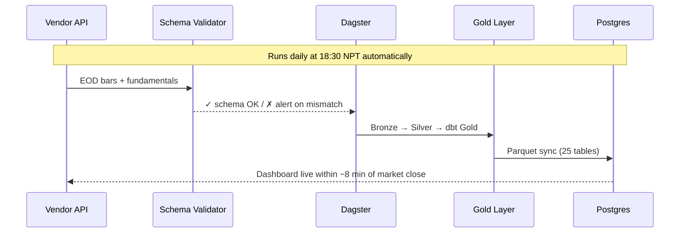
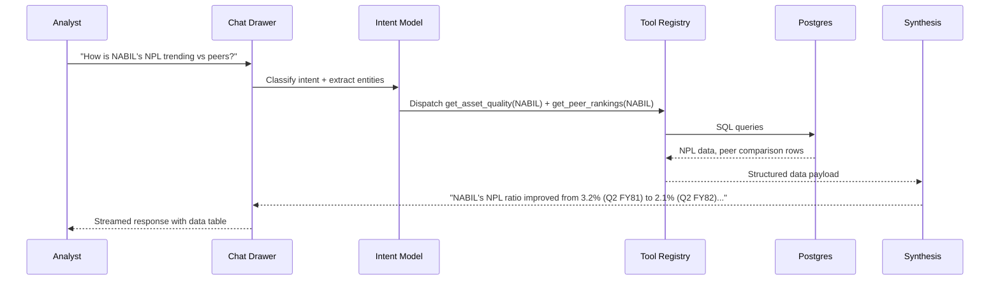
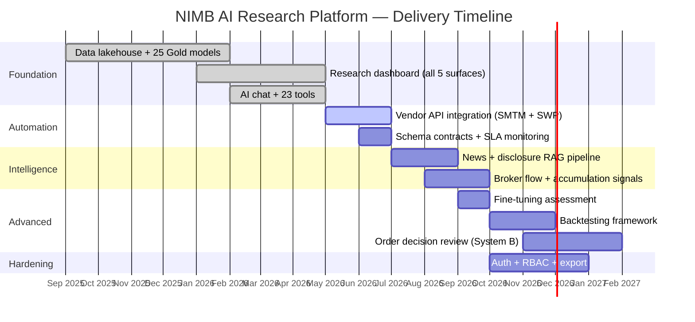

# NIMB AI Research Platform — Product Roadmap

> **Audience:** NIMB leadership, research team leads, dev/management  
> **Purpose:** Full-system vision from raw data to AI-augmented research decisions  
> **Status as of:** May 2026

---

## Vision

Replace fragmented, manual analysis with a unified, data-driven research platform.

**Today:** Analyst downloads CSVs → copies into Excel → eyeballs charts → writes note.  
**Target:** Automated daily ingestion → computed analytics → AI copilot that answers "how is NABIL's asset quality trending?" in seconds, with evidence.

---

## System Architecture Overview

```mermaid
flowchart LR
    classDef done fill:#166534,color:#fff,stroke:none
    classDef inprog fill:#92400e,color:#fff,stroke:none
    classDef planned fill:#1e3a5f,color:#fff,stroke:none

    subgraph ING["① INGEST"]
        V1[Vendor APIs\nSMTM · SWP]
        V2[Manual CSVs\nQuarterly drops]
        V3[Scrapers\nSharesansar]
    end

    subgraph STR["② STORAGE — Lakehouse"]
        BZ[Bronze\nRaw Delta]
        SV[Silver\nCanonical Delta]
        GL[Gold\nAnalytics Parquet]
    end

    subgraph CMP["③ COMPUTE"]
        DK[DuckDB\nLocal SQL engine]
        DBT[dbt-duckdb\n25 models]
        DAG[Dagster\nDAG orchestration]
    end

    subgraph SRV["④ SERVING"]
        PG[Postgres 16\n+ pgvector]
        VDB[Vector Store\nEmbeddings]
        API[FastAPI\n40+ endpoints]
        RED[Redis\nSession cache]
    end

    subgraph AI["⑤ AI LAYER"]
        INT[Intent Model\nGemini Flash-Lite]
        TOL[Tool Registry\n23 tools]
        SYN[Synthesis Model\nGemini Flash]
        RAG[RAG Pipeline\nNews · Disclosures]
    end

    subgraph UI["⑥ PRESENTATION"]
        DSH[Dashboard\nUniverse · Scrip · Compare]
        CHT[Chat Drawer\nContext-aware]
        SCR[Screens\n5 strategy presets]
        CMD[⌘K Palette]
    end

    ING --> STR --> CMP --> SRV --> AI --> UI

    class V1,V2,V3 done
    class BZ,SV,GL done
    class DK,DBT,DAG done
    class PG,API,RED done
    class INT,TOL,SYN done
    class DSH,CHT,SCR,CMD done
    class VDB,RAG planned
```

---

## Delivery Phases

### Phase 1 — Data Foundation ✅ DELIVERED

**Goal:** Get clean, structured financial data into a queryable store.

| Deliverable | Detail | Status |
|---|---|---|
| Lakehouse architecture | Bronze → Silver → Gold tiers in MinIO/Delta/Parquet | ✅ Done |
| Vendor CSV ingestion | Quarterly fundamentals (15 metrics × 19 banks), price history, corporate actions | ✅ Done |
| Silver contracts | Typed Pydantic schemas for fundamentals, market, scrip master, corporate actions | ✅ Done |
| dbt Gold models | 25 computed analytics tables (DuPont, Piotroski, valuation history, scorecard…) | ✅ Done |
| Postgres sync | All 25 Gold tables land in Postgres nightly | ✅ Done |
| Dagster orchestration | `daily_eod_job` DAG with asset materialisation + alerting | ✅ Done |

**Business value delivered:** From "no structured data" to 25 computed analytics tables refreshed nightly, covering all 19 commercial banks across fundamentals, valuation, risk, capital, and income dimensions.

---

### Phase 2 — Automated Data Pipeline ⚠️ IN PROGRESS

**Goal:** Replace manual OneDrive drops with automated, schema-validated vendor feeds.

| Deliverable | Detail | Status |
|---|---|---|
| SMTM API integration | Live market data, floor-sheet (buyer/seller broker IDs), daily bars | 🔲 Planned |
| SmartWealthPro integration | Fundamentals, corporate actions, company profiles (~80% coverage) | 🔲 Planned |
| Schema contract enforcement | Dagster sensor — fail loudly if vendor changes column names or types | 🔲 Planned |
| Automatic EOD ingestion | No human needed for daily data refresh | 🔲 Planned |
| Corporate action auto-ingestion | Dividend, bonus, rights, splits on board-decision day | 🔲 Planned |
| Vendor SLA monitoring | Alert if feed is late by > 2 hrs | 🔲 Planned |

**Why this matters:** Right now a human manually downloads and uploads CSVs. One missed upload = stale data for the whole platform. Automation removes this fragility entirely.

---

### Phase 3 — Research Dashboard ✅ DELIVERED

**Goal:** A dense, evidence-first UI that research analysts actually want to use.

| Surface | What it shows | Status |
|---|---|---|
| Universe Overview | All 19 banks — composite score, quadrant, 6m return, P/E tier, dividend yield, market cap | ✅ Done |
| Filter bar | Sector, size tier, quality tier, quadrant, NPL band — URL-shareable | ✅ Done |
| Scrip Detail | 8 tabs: Performance · Fundamentals · Valuation · Asset Quality · Capital · Income · Technicals · Quality | ✅ Done |
| Compare View | Side-by-side multi-scrip metric grid with delta columns + heatmap | ✅ Done |
| Screen Presets | Top Quality · Cheap vs Self · High Yield · Contrarian · Turnaround | ✅ Done |
| Command Palette ⌘K | Search scrips, navigate, ask chat, run "compare NABIL NICA HBL" | ✅ Done |
| Dark mode | Full dual-theme, persisted to localStorage | ✅ Done |

**Design principle:** No BUY/SELL verdicts anywhere in the UI. All classification labels are descriptive (TOP\_DECILE, CONTRARIAN\_BET, VERY\_CHEAP) — positioning data, not advice. Every score shows its component breakdown.

---

### Phase 4 — AI Chat System ✅ DELIVERED (core) / 🔲 RAG pending

**Goal:** A research copilot that answers analytical questions with computed evidence, not hallucinations.

| Component | Detail | Status |
|---|---|---|
| 23-tool registry | Financial analytics tools (fundamentals, valuation, Piotroski, DuPont, returns…) | ✅ Done |
| Gemini 2.5 Flash-Lite | Intent classification + tool dispatch | ✅ Done |
| Gemini 2.5 Flash | Synthesis + response generation | ✅ Done |
| Context injection | Chat drawer reads current page (`/scrip/NABIL` → injects "user is viewing NABIL") | ✅ Done |
| Persistent drawer | Chat available on every page, shares session with `/chat` history page | ✅ Done |
| QueryTrace audit log | Every tool call logged to Postgres for review | ✅ Done |
| **RAG — news + disclosures** | Embed NEPSE announcements + press releases into pgvector; cite sources in responses | 🔲 Phase 5 |
| **RAG — research notes** | Internal analyst notes searchable via vector similarity | 🔲 Phase 5 |

---

### Phase 5 — Intelligence Layer 🔲 PLANNED

**Goal:** Go beyond structured analytics — add news intelligence, broker flow analysis, and vector search.

| Deliverable | Detail | Business value |
|---|---|---|
| News ingestion pipeline | Scrape/API NEPSE announcements, company disclosures, press releases daily | Chat can cite "per NEPSE circular dated 2025-03-12…" |
| NLP sentiment scoring | Classify announcement sentiment (positive / neutral / negative / material) | Analysts get an early flag on material events |
| pgvector embeddings | Embed news + disclosures; store in Postgres pgvector extension | Vector similarity search already provisioned |
| RAG-augmented chat | Tool `search_disclosures(scrip, query)` → LLM cites source documents | Grounded responses, not just computed metrics |
| Broker flow analytics | Aggregate floor-sheet by buyer/seller broker → net daily flow per scrip | "Which brokers are accumulating NABIL?" — data, not rumour |
| Accumulation/distribution zone | Statistical detection from floor-sheet volume patterns | Signals when a scrip is being quietly accumulated |
| Circuit touch history | Log every upper/lower circuit event per scrip | Context for unusual price moves |

**Data dependency:** SMTM floor-sheet API (Phase 2) is required for broker flow analytics.

---

### Phase 6 — Advanced AI & Fine-Tuning 🔲 PLANNED

**Goal:** Specialise the AI layer for Nepal market domain knowledge.

| Deliverable | Detail | Notes |
|---|---|---|
| Domain fine-tuning assessment | Evaluate whether Gemini / OSS model (Llama 3.1, Mistral) benefits from NEPSE-specific fine-tuning | Required data: historical analyst Q&A pairs, earnings call transcripts |
| Fine-tuning pipeline | If warranted: curate dataset → fine-tune on Vertex AI → A/B test vs base model | Only if base model shows systematic gaps on Nepal-specific questions |
| Multi-sector expansion | Extend Gold models beyond commercial banks → hydro, manufacturing, development banks | Requires vendor data for those sectors |
| Portfolio-level analysis | Analyse a basket of scrips as a portfolio — correlation, concentration, attribution | Tool: `analyze_portfolio(scrips, weights)` |
| Backtesting framework | Replay historical signals (Piotroski, scorecard, valuation tier) against actual returns | Validates model predictive power |

**On fine-tuning:** The current Gemini 2.5 Flash base model handles Nepal-specific terminology well because the tool registry supplies structured data. Fine-tuning is a second-order improvement — defer until the data pipeline (Phase 2) and RAG layer (Phase 5) are stable.

---

### Phase 7 — System B: Order Decision Review 🔲 PLANNED

**Goal:** A closed-loop system that connects research insights to actual order decisions for review and learning.

| Deliverable | Detail |
|---|---|
| NIMB order feed integration | Ingest NIMB's historical order placement data (symbol, quantity, price, date, side) |
| Decision metadata tagging | Analyst tags each order with the thesis ("buying on valuation dip", "reducing after NPL spike") |
| Research-to-order tracing | Link order to the analytics snapshot at decision time (was the scorecard high? was NPL rising?) |
| Outcome attribution | 3m/6m/1y return attribution per decision — which theses worked? |
| Review dashboard | "Decisions review" page: list all past orders, their thesis tags, scorecard at time, and actual outcome |
| AI review | Chat can answer "which of our past decisions had the most predictive fundamentals?" |

**Business value:** Institutional learning — NIMB builds a proprietary dataset of what actually worked in the Nepal market.

---

### Phase 8 — Production Hardening 🔲 PLANNED

| Deliverable | Detail |
|---|---|
| Authentication + RBAC | Analyst vs Viewer vs Admin roles; session management |
| Rate limiting + API keys | Prevent abuse; per-user query limits |
| Audit logging | Every data access + every LLM call logged |
| SLA monitoring | Dagster alerts if any pipeline step misses its window |
| Mobile-responsive UI | Full tablet support; phone read-only view |
| Export + share | PDF export of scrip detail tabs; shareable links with snapshot data |
| Multi-environment | Dev → Staging → Prod promotion pipeline |

---

## Timeline Overview

---

## Data Stack Summary

| Layer | Technology | Role |
|---|---|---|
| Orchestration | **Dagster** | DAG scheduling, asset materialisation, alerting |
| Object storage | **MinIO** (S3-compatible) | Bronze/Silver Delta + Gold Parquet files |
| Local compute | **DuckDB** | Fast SQL over Parquet without a cluster |
| Transformation | **dbt-duckdb** | 25 Gold analytics models, tested, versioned |
| Serving DB | **Postgres 16 + pgvector** | Structured query serving + vector similarity search |
| Session cache | **Redis** | Chat session state |
| API | **FastAPI** | 40+ REST endpoints, SSE streaming |
| LLM — intent | **Gemini 2.5 Flash-Lite** | Fast, cheap intent classification |
| LLM — synthesis | **Gemini 2.5 Flash** | High-quality response generation |
| Tool registry | **23 Python functions** | Deterministic, testable data retrieval |
| Frontend | **Next.js 16** | App router, server components |
| Charts | **Recharts** | Lightweight, Tailwind-compatible |
| Data table | **TanStack Table v8** | Sortable, filterable, virtualised |
| Styling | **Tailwind CSS v4** | CSS variable theming, dual light/dark |

---

## What We're Not Building (and Why)

| Deferred item | Reason |
|---|---|
| Real-time order execution | NIMB executes via TMS — platform is research-only by design |
| Price alerts / push notifications | Useful, but not a research workflow blocker |
| Custom screen builder | Preset screens cover 95% of use cases; builder adds UX complexity |
| Mobile trading app | Research platform is desktop-first for analyst workflow |
| Automated trading signals | Out of scope — platform provides data and evidence, not decisions |

---

## Current Coverage vs Data Sources

| Data domain | Today (manual CSVs) | After Phase 2 (APIs) |
|---|---|---|
| Quarterly fundamentals (19 banks) | ✓ Manual drops | ✓ SmartWealthPro API |
| Daily EOD price bars | ✓ Manual / scraper | ✓ SMTM + SWP |
| Corporate actions | ✓ Manual | ✓ SWP API |
| Live market quotes | — | ✓ SMTM API |
| Floor-sheet (broker flows) | — | ✓ SMTM API |
| NEPSE announcements / news | — | ✓ Phase 5 RAG pipeline |
| Sector / index data | Partial scraper | ✓ SWP API |
| Promoter shareholding | — | Vendor TBD |
| Insider transactions | — | Vendor TBD |

---

## Key Metrics to Track

| Metric | Current | Target (12 months) |
|---|---|---|
| Data freshness | Manual (~weekly) | Automated (daily, T+8h) |
| Banks covered | 19 commercial banks | 19 + hydro + dev banks |
| Gold analytics models | 25 | 35+ (add non-bank sectors) |
| LLM tools | 23 | 35+ (add RAG + portfolio tools) |
| Research questions answerable by chat | ~60% | ~85% |
| Analyst time saved per research note | — | Baseline TBD (track in System B) |

---

*Platform codebase: `nep-trade-analytics/` — tracked in version control, deployed via Docker Compose.*  
*Architecture detail: `docs/ARCHITECTURE.md` · Vendor requirements: `docs/DATA_VENDOR_CONTRACT.md`*
